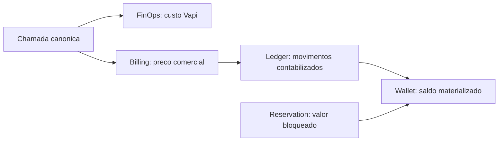
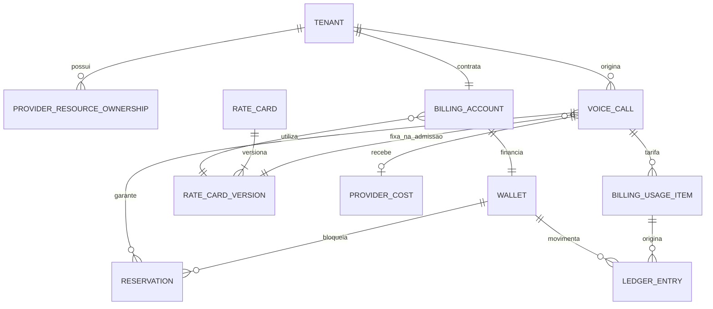
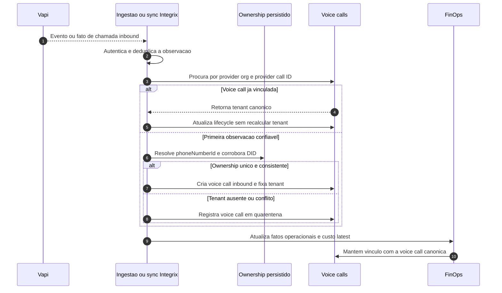
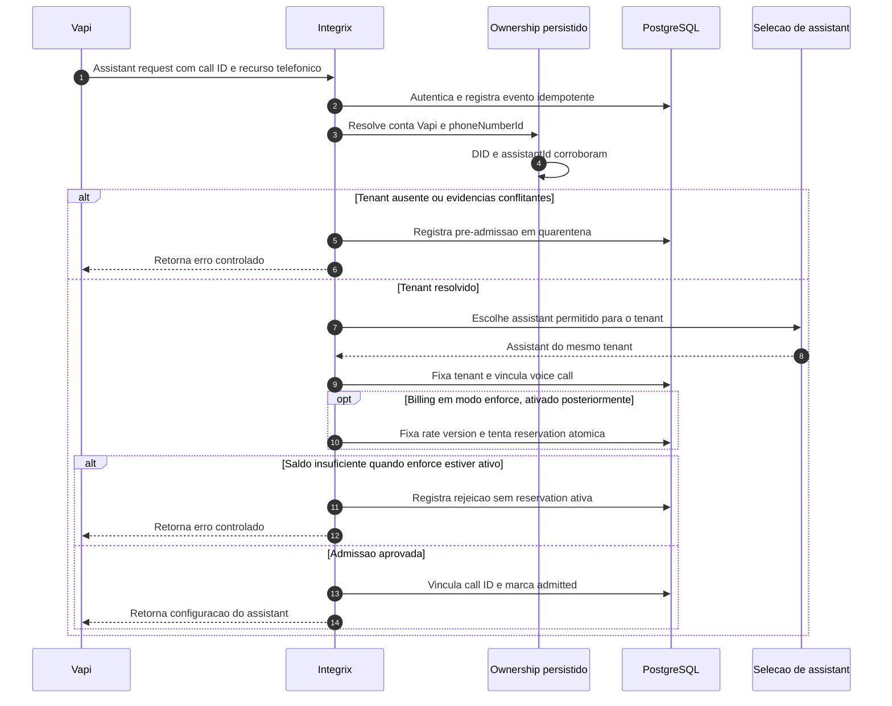
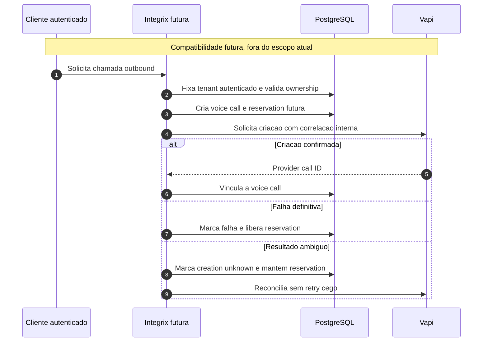

# Arquitetura De Chamadas, Billing, Wallet E FinOps

> Status: proposta arquitetural de referencia, com ownership e reconciliacao
> de `voice_call` implementados em shadow e sem enforcement produtivo.
>
> Escopo: modelo de dominio, fluxos conceituais e registro do estado incremental.
>
> Contexto operacional atual: a Integrix opera somente chamadas inbound.
> Outbound aparece apenas como compatibilidade arquitetural futura e esta fora
> do escopo de implementacao, preparacao de endpoints e reservations atuais.
>
> Publico: pessoas desenvolvedoras e assistentes de IA trabalhando no
> repositorio IntegrixAI.

## Estado Da Implementacao

A migration `0008_tenant_ownership` introduz somente a fundacao persistida:
`tenant`, `provider_resource` e `provider_resource_ownership`. Ela cadastra
apenas o tenant `pbsaude`; nao cria um Tenant Demo e nao modifica os dados ou
mappings legados usados pelo runtime atual.

Existe tambem um avaliador read-only de shadow para extrair evidencias e testar
ownership persistido. `assistantId` sozinho e insuficiente no shadow, mesmo que
o resolver legado ainda o aceite durante a janela de compatibilidade.

A migration `0009_voice_call_reconcile` adiciona `voice_calls`, a inbox
idempotente `provider_event_receipts` e o vinculo opcional de
`vapi_call_costs.voice_call_id`. O reconciliador:

- fixa `tenant_id` no maximo uma vez, com protecao adicional no PostgreSQL;
- preserva o tenant canonico diante de eventos posteriores;
- mantem conflitos em reconciliacao/quarentena sem escolher vencedor;
- deduplica observacoes sanitizadas e impede regressao por snapshot antigo;
- usa o instante original da chamada para consultar ownership historico.

O sync de custos pode alimentar esse caminho somente quando
`VOICE_CALL_SHADOW_ENABLED=true`. A flag e `false` por padrao e falhas do shadow
nao interrompem a projecao FinOps existente. `/tools`, dashboard e o resolver
produtivo continuam inalterados. Como nao ha payload real validado nem webhook
geral de eventos Vapi no projeto, nenhum endpoint novo foi inventado.

Ainda nao foram implementados `assistant-request`, Billing, Wallet,
Reservation, Rate Card, Usage Item, Ledger ou qualquer fluxo outbound.

## Como Um Assistente De IA Deve Usar Este Documento

Ao planejar ou implementar esta arquitetura:

1. Assuma que todo o fluxo produtivo atual e inbound.
2. Nao implemente nem prepare endpoint, adapter de criacao, reservation ou
   reconciliacao especifica para outbound sem uma decisao futura explicita.
3. Trate as decisoes marcadas como alinhadas como restricoes, nao como sugestoes.
4. Consulte tambem [tenant-safety.md](tenant-safety.md) para qualquer mudanca
   tenant-sensitive.
5. Confirme o comportamento real no codigo e nos testes antes de editar.
6. Preserve o dashboard e os contratos existentes durante a migracao.
7. Implemente uma fase pequena por vez, com compatibilidade e feature flags.
8. Nao transforme custo Vapi em preco comercial nem reservation em movimento
   contabil.

## Resumo Executivo

O produto atual recebe somente chamadas inbound. A prioridade arquitetural e
persistir ownership de `phoneNumberId` e DID, criar a `voice_call` canonica e
fazer ingestao e reconciliacao convergirem para essa identidade.

`voice_call` sera a fonte de verdade do tenant ao qual a chamada pertence. O
tenant e fixado na admissao ou na primeira vinculacao confiavel e nunca e
recalculado por webhook, sync ou mudanca posterior de mappings.

Depois do encerramento da chamada, existem duas trilhas independentes:

- **FinOps** responde quanto a Vapi cobrou da Integrix.
- **Billing** responde quanto o cliente deve pagar segundo seu contrato.

O **Ledger** registra os movimentos financeiros efetivamente contabilizados.
A **Wallet** materializa o saldo disponivel para decisoes atomicas de admissao.
Uma **Reservation** apenas bloqueia capacidade de gasto; ela nao e um
lancamento no ledger.



## Decisoes Ja Alinhadas

- Todo o fluxo produtivo atual e inbound.
- Outbound nao faz parte do escopo atual. Nao serao preparados endpoint de
  criacao, adapter de criacao, reservation, retry ou reconciliacao especifica
  para outbound.
- O modelo preserva `direction` e IDs provider-neutral para permitir outbound
  no futuro sem redesenho, mas isso nao cria trabalho na entrega atual.
- `voice_calls` sera a fonte de verdade da identidade da chamada e do
  `tenant_id`.
- O tenant sera fixado na admissao ou criacao da chamada e nunca recalculado
  posteriormente.
- Uma chamada em pre-admissao pode estar sem tenant somente enquanto estiver
  em quarentena. A vinculacao `sem tenant -> tenant` e unica, auditada e
  irreversivel.
- Conflitos entre DID, `phoneNumberId`, `assistantId` ou outros identificadores
  geram quarentena ou rejeicao. Nao existe prioridade silenciosa entre
  identificadores conflitantes.
- No inbound, a identidade preferencial e `provider + orgId + phoneNumberId`.
- Se `phoneNumberId` nao estiver disponivel, DID, endpoint SIP e
  `telephony_credential_id` persistidos podem ser evidencias autoritativas.
- `assistantId` e somente evidencia secundaria de consistencia. Ele nunca
  identifica tenant sozinho, nunca vence conflito e nunca substitui um
  `phoneNumberId` presente mas sem ownership conhecido.
- No inbound, `customer.number` nao identifica tenant.
- `telephony_credential_id` identifica a credencial do transporte SIP. Ele nao
  representa e nunca deve armazenar segredo ou credencial de autenticacao de
  Server URL/webhook.
- A identidade da organizacao usa o `orgId` real da Vapi. O novo modelo nao usa
  conta de provedor ficticia chamada `default`.
- Para PB Saude, endpoint SIP/Phone Number pertence a `pbsaude`; assistants
  atuais e futuros apenas corroboram esse ownership. Trocar assistant nao muda
  tenant, historico, FinOps ou Billing.
- Mappings e ownership de numeros e assistants sairao gradualmente de
  environment e serao persistidos com historico.
- `vapi_call_costs` continuara como projecao FinOps do ultimo custo conhecido,
  nao como ledger e nao como resultado comercial.
- FinOps, Billing, Wallet e Ledger sao dominios separados.
- Ledger e append-only. Correcoes usam novos lancamentos compensatorios.
- Wallet tem saldo materializado e reservations, mas deve ser reconciliavel
  com Ledger e reservations ativas.
- PostgreSQL e a fonte transacional. Criacao e alteracao de reservations usam
  operacao atomica.
- Webhook e sync alimentam e reconciliam fatos. Eles nao geram cobranca
  diretamente.
- Settlement comercial e idempotente.
- `billing_usage_items` armazena o resultado comercial da tarifacao.
- Rate cards sao versionados e a versao e fixada na admissao da chamada.
- Custo Vapi, FX e preco comercial sao independentes.
- Organizacao Vapi dedicada por cliente e uma excecao Enterprise.
- Shadow mode vem antes de alertas e de qualquer enforcement.

## Auditoria Dos Payloads Inbound Atuais

Auditoria local realizada em 19 de agosto de 2026. Naquele momento, o codigo,
os artefatos versionados e o PostgreSQL local nao continham um payload real
completo de chamada inbound.

Em 20 de agosto de 2026, uma auditoria sanitizada dos snapshots FinOps de
producao encontrou dez chamadas `inboundPhoneCall`. Todas apresentavam o mesmo
`orgId` real e o mesmo `phoneNumberId`; DID/`to` nao estava disponivel nesses
snapshots. Registros `webCall` foram explicitamente excluidos como evidencia de
ownership telefonico. Os valores reais permanecem somente no ambiente privado
e nao devem ser versionados.

| Campo | Leitura atual no codigo | Evidencia real local | Contrato esperado da Vapi | Decisao antes do runtime |
|---|---|---|---|---|
| `call.id` | `/tools` e sync leem | Confirmado no snapshot FinOps inbound | Existe no recurso Call | Correlacao canonica |
| `orgId` | Shadow e sync leem | Confirmado no snapshot FinOps inbound | Existe no recurso Call/Phone Number | Persistir o valor real; sem `default` |
| `phoneNumberId` | `/tools` e sync leem | Confirmado no snapshot FinOps inbound | Existe no recurso Call | Evidencia principal |
| `phoneNumber.id` | `/tools` le como alternativa | Somente testes sinteticos | Existe no objeto Phone Number | Normalizar para `phone_number_id` |
| Numero/DID | `call.to` e sync leem candidatos | Somente testes sinteticos | Existe em contratos telefonicos | Fallback apenas com ownership |
| Credential SIP | Nao e lida | Nao observada | `credentialId` existe no recurso Phone Number | Aceitar apenas como `telephony_credential_id` inequívoco |
| `assistantId` | `/tools` e sync leem | Somente testes; artefato contem ID de transferencia | Existe no recurso Call | Somente corroboracao |
| Destino SIP | Nao e lido | Nao observado | A rota SIP usa endpoint/credential | Confirmar formato antes de ativar |
| Headers SIP | Nao sao lidos | Nao observados | Podem existir no transporte SIP | Registrar no maximo nomes sanitizados |

As referencias de contrato indicam o que a API pode fornecer, nao provam o que
os webhooks atuais da conta Integrix realmente entregam. Antes de conectar o
shadow ao runtime, devem ser capturadas amostras sanitizadas de pelo menos tres
chamadas inbound da PB Saude, incluindo `assistant-request` quando ele for
introduzido, evento final e resposta de consulta `GET /call`. Valores de
headers, tokens e segredos nao devem ser persistidos nessa auditoria.

O cadastro operacional deve usar
`python -m scripts.register_provider_resource_ownership`, que e dry-run por
padrao e exige `--apply` para persistir. O comando rejeita tenant inexistente ou
inativo, ownership ativo de outro tenant, sobreposicao historica e conflito de
metadados de telefonia. IDs reais devem ser passados somente no host privado.

Enquanto a validacao de DID, endpoint e credencial SIP nao ocorrer:

- nenhum desses campos se torna obrigatorio nos endpoints existentes;
- ausencia ou conflito continua sendo resultado do avaliador de shadow;
- o resolver produtivo e seus mappings de environment permanecem intactos;
- nao existe fallback automatico para `assistantId` no desenho novo.

## Invariantes De Seguranca E Contabilidade

1. Depois de definido, `voice_call.tenant_id` nunca muda.
2. Um evento posterior procura a chamada pelo vinculo canonico; nao executa
   novamente a resolucao de tenant.
3. Um recurso Vapi so pode ter um ownership ativo por vez dentro da mesma
   organizacao real do provedor.
4. Transferencias de ownership preservam o historico e a vigencia temporal.
5. Nenhuma chamada e admitida quando os identificadores apontam para tenants
   diferentes.
6. Uma chamada, reservation, usage item ou movimento financeiro nunca cruza
   tenants ou billing accounts.
7. Entregas duplicadas e reprocessamentos nao duplicam reservations, usage
   items ou lancamentos.
8. Custo do provedor ou FX corrigido nao altera cobranca comercial ja
    contabilizada.
9. Correcao comercial cria ajuste; nao sobrescreve usage ou ledger anterior.
10. Saldo contabilizado da wallet deve ser reconstruivel pelo ledger.
11. Total reservado da wallet deve ser reconstruivel pelas reservations nao
    terminais.

## Glossario Canonico

| Termo | Significado |
|---|---|
| Admissao | Decisao de aceitar uma chamada, fixar tenant e politica comercial e, quando aplicavel, reservar credito. |
| Provider resource | Numero, DID, endpoint SIP, credencial telefonica ou assistant identificado dentro de uma organizacao real da Vapi. |
| Ownership | Relacao temporal entre um provider resource e um tenant. |
| Voice call | Identidade interna e canonica de uma chamada. Na operacao atual, sempre inbound; o campo de direcao preserva compatibilidade futura. |
| Provider cost | Custo operacional informado pela Vapi. |
| Rate card | Identidade logica de uma tabela de precos. |
| Rate card version | Conjunto imutavel de precos e regras comerciais em uma vigencia. |
| Billing usage item | Resultado detalhado da tarifacao comercial de uma chamada. |
| Reservation | Bloqueio temporario de credito para garantir a chamada. |
| Settlement | Transformacao idempotente do usage finalizado em movimento financeiro e captura/liberacao da reservation. |
| Ledger | Historico append-only dos movimentos financeiros contabilizados. |
| Wallet | Materializacao do saldo contabilizado e do total reservado. |
| Shadow mode | Calcula e registra decisoes hipoteticas sem bloquear chamadas nem debitar saldo real. |
| Quarentena | Estado seguro para dados sem tenant confiavel ou com evidencias conflitantes. |

## Modelo De Dominio Minimo



### Tenant

- **Responsabilidade:** representar a fronteira canonica do cliente dentro da
  Integrix.
- **Relacionamentos:** possui recursos Vapi, chamadas e um billing account na
  primeira versao.
- **Imutavel:** ID interno e identidade historica. Nome, status e configuracoes
  podem mudar.
- **Source of truth:** existencia, identidade e status operacional do tenant.
  Nao e fonte de saldo nem de ownership historico.

### Recursos Vapi E Ownership

Este dominio precisa de dois conceitos persistidos:

- `provider_resource`: provedor, `provider_org_id` real, tipo, ID externo e
  metadados normalizados. Os tipos iniciais sao `phone_number`, `did`,
  `sip_endpoint`, `telephony_credential` e `assistant`.
- `provider_resource_ownership`: tenant proprietario e periodo de vigencia.

Regras:

- **Responsabilidade:** registrar numeros, DIDs, endpoints/credenciais SIP,
  `phoneNumberId`, assistants e seu proprietario em determinado instante.
- **Relacionamentos:** um recurso possui ownerships historicos; cada ownership
  aponta para um tenant. A voice call guarda os recursos usados como evidencia.
- **Imutavel:** provedor, `provider_org_id`, tipo e ID externo do recurso. Troca
  de tenant encerra um ownership e cria outro; nao sobrescreve historia.
- **Source of truth:** ownership do recurso no instante da admissao ou evento.

A identidade do recurso inclui o `orgId` real da Vapi mesmo enquanto a Integrix
usar apenas uma organizacao. Nao existe fallback para uma conta `default`. Isso
permite a excecao Enterprise sem redesenho.

`telephony_credential_id` nomeia exclusivamente a credencial/endpoint de
telefonia SIP. Credenciais de Server URL e webhook pertencem ao dominio de
seguranca da integracao e nao entram em `provider_resource`.

### Voice Call

- **Responsabilidade:** manter a identidade canonica, tenant admitido, direcao,
  correlacao com a Vapi e ciclo operacional da chamada.
- **Relacionamentos:** pertence a tenant; fixa billing account e rate card
  version; possui reservation, provider cost e billing usage items.
- **Imutavel:** ID interno, direcao, origem da admissao e, depois da admissao,
  tenant, billing account e rate card version. O ID externo, depois de
  vinculado, nao muda.
- **Source of truth:** identidade interna, tenant da chamada e vinculo com o ID
  do provedor.

Uma chamada de pre-admissao em quarentena pode ter tenant ausente. A unica
vinculacao posterior permitida e uma resolucao auditada e irreversivel. Webhook,
sync e alteracao de mappings nunca trocam um tenant ja fixado.

### Provider Cost E FinOps

- **Responsabilidade:** manter duracao, componentes de custo, moeda, FX e custo
  convertido mais recentes informados pela Vapi.
- **Relacionamentos:** pertence a uma voice call e pode ser atualizado por
  webhook ou sync.
- **Imutavel:** identidade `provider + provider_call_id`. Observacoes brutas sao
  imutaveis; a projecao do ultimo custo conhecido pode ser corrigida.
- **Source of truth:** `vapi_call_costs` e a leitura interna do ultimo custo
  conhecido. A Vapi continua sendo a autoridade externa. Esse dado nao e fonte
  de cobranca comercial.

### Billing Account

- **Responsabilidade:** representar contrato comercial, moeda, situacao, modo
  de enforcement, politica de credito e rate card aplicavel.
- **Relacionamentos:** pertence a tenant na primeira versao, possui wallet e usa
  versoes de rate card.
- **Imutavel:** ID interno e moeda. Mudanca de moeda exige outra conta.
- **Source of truth:** situacao comercial e modo `shadow`, `alert` ou `enforce`.

Tenant e billing account permanecem separados para permitir mais de uma unidade
pagadora no futuro, mesmo que a primeira versao use relacao um para um.

### Wallet

- **Responsabilidade:** materializar saldo contabilizado e total reservado para
  decisoes atomicas de admissao.
- **Relacionamentos:** pertence ao billing account, possui reservations e recebe
  movimentos do ledger.
- **Imutavel:** ID, billing account e moeda. Os valores materializados mudam.
- **Source of truth:** disponibilidade operacional imediata. O ledger e a fonte
  contabil; as reservations sao a fonte dos bloqueios.

Formula conceitual:

```text
saldo disponivel = saldo contabilizado - total reservado
```

### Reservation

- **Responsabilidade:** bloquear valor para uma chamada antes de permitir o
  consumo.
- **Relacionamentos:** pertence a wallet e voice call; no settlement e capturada
  ou liberada.
- **Imutavel:** ID, wallet, moeda, chave idempotente e valor originalmente
  reservado.
- **Source of truth:** existencia, valor e situacao do bloqueio financeiro.

A criacao da reservation e a alteracao do total reservado da wallet ocorrem na
mesma transacao atomica. Reservation nao e movimento de ledger.

### Rate Card E Rate Card Version

- **Responsabilidade:** definir preco, unidade, arredondamento, incremento,
  minimo, setup fee e regras para chamadas nao atendidas.
- **Relacionamentos:** um rate card possui versoes; billing accounts usam
  versoes e voice calls fixam uma versao na admissao.
- **Imutavel:** uma versao publicada inteira. Correcoes criam nova versao.
- **Source of truth:** regra comercial usada para calcular o preco da chamada.

A versao e fixada na admissao para impedir que mudancas durante a chamada
alterem o seu preco.

### Billing Usage Item

- **Responsabilidade:** registrar o resultado comercial da tarifacao de uma
  chamada.
- **Relacionamentos:** aponta para voice call, billing account e rate card
  version; pode originar lancamentos no ledger.
- **Imutavel:** depois de finalizado, quantidade medida, quantidade faturavel,
  regras aplicadas, versao tarifaria e valor calculado.
- **Source of truth:** quanto a chamada custa ao cliente e como o valor foi
  calculado.

Correcao comercial cria usage item de ajuste. O item original nao e alterado.

### Ledger

- **Responsabilidade:** registrar creditos, debitos, ajustes, estornos e
  capturas efetivamente contabilizados.
- **Relacionamentos:** pertence a wallet e pode referenciar usage item,
  reservation, recarga, ajuste ou estorno.
- **Imutavel:** todo lancamento. Ledger e append-only.
- **Source of truth:** movimentos contabilizados e reconstrucao do saldo da
  wallet.

Cada movimento possui chave de idempotencia de negocio. Uma correcao usa novo
lancamento compensatorio, nunca update ou delete do movimento anterior.

### Entidade Tecnica De Ingestao

Um `provider_event_receipt`, ou inbox equivalente, e necessario para garantir
ingestao confiavel.

Ele registra de forma imutavel:

- provedor e tipo do evento;
- identificador externo ou hash deduplicador;
- provider call ID;
- instante de recebimento;
- payload protegido;
- situacao de processamento ou quarentena.

Essa entidade permite deduplicacao, reprocessamento e tratamento de webhook e
sync fora de ordem. Ela registra o fato bruto, mas nao decide tenant nem cobra.

## Mapa De Fontes De Verdade

| Conceito | Source of truth |
|---|---|
| Identidade e status do cliente | `tenant` |
| Ownership historico de numero ou assistant | `provider_resource_ownership` |
| Identidade e tenant da chamada | `voice_call` |
| Evento bruto recebido | `provider_event_receipt` |
| Ultimo custo Vapi conhecido | `vapi_call_costs` ou projecao FinOps equivalente |
| Politica comercial | `billing_account` e `rate_card_version` |
| Resultado da tarifacao | `billing_usage_item` |
| Bloqueio de credito | `reservation` |
| Movimentos financeiros | `ledger_entry` |
| Disponibilidade usada na admissao | `wallet`, reconciliavel com ledger e reservations |

## Fluxo Inbound Atual: Ingestao E Reconciliacao

Este e o primeiro fluxo a ser suportado pela arquitetura. Ele nao depende de
`assistant-request`, Wallet, Billing ou reservation.



Regras prioritarias:

1. `provider + orgId + provider call ID` identifica a chamada externa.
2. `provider + orgId + phoneNumberId` identifica o recurso telefonico.
3. DID, endpoint SIP ou `telephony_credential_id` resolvem somente quando
   `phoneNumberId` nao estiver presente e seu ownership for unico e persistido.
4. `assistantId` apenas corrobora; sozinho e insuficiente e nunca vence conflito.
5. Uma voice call ja vinculada fornece o tenant para todos os eventos futuros.
6. Sync e ingestao podem chegar em qualquer ordem e devem convergir para a
   mesma voice call.
7. Custo latest continua em FinOps e nao gera cobranca.
8. Nenhuma reservation ou regra de saldo entra nesta primeira etapa.

## Fluxo Inbound Posterior: Assistant Request E Billing

Este fluxo vem somente depois de ownership, voice call e reconciliacao estarem
estaveis. A primeira ativacao de `assistant-request` pode escolher o assistant
sem enforcement financeiro; reservation entra posteriormente com Billing.



### Regras De Resolucao Inbound

1. Autenticar a requisicao do provedor antes de resolver tenant.
2. Usar `provider + orgId + phoneNumberId` como identidade principal.
3. Quando `phoneNumberId` estiver ausente, usar DID, endpoint SIP ou
   `telephony_credential_id` somente quando persistido e inequivoco.
4. Tratar `assistantId` somente como evidencia de consistencia. Ele sozinho e
   insuficiente e nao vence conflito.
5. Nunca usar `customer.number` como identidade do tenant.
6. Resolver tenant antes de escolher assistant.
7. Garantir que o assistant escolhido pertence ao tenant resolvido.
8. Evitar CRM ou integracoes lentas no caminho de admissao.
9. Responder dentro do limite operacional do contrato Vapi.
10. Ativar primeiro apenas a resolucao e selecao do assistant.
11. Em Billing shadow, registrar se a chamada seria recusada, mas nao bloquear
    nem alterar saldo real.
12. Reservation real aparece somente na fase posterior de enforcement inbound.

## Estados De Voice Call

Admissao e ciclo do provedor sao eixos separados. Billing nao deve ser
misturado no estado operacional da chamada.

### Estado De Admissao

| Estado | Significado |
|---|---|
| `pending` | Identidade e politica ainda estao sendo validadas. |
| `admitted` | Tenant foi fixado e a chamada foi autorizada. |
| `rejected` | Rejeicao definitiva por autenticacao, ownership, politica ou saldo. |
| `quarantined` | Tenant ausente ou evidencias conflitantes. |

### Estado Do Provedor

| Estado | Significado |
|---|---|
| `scheduled` | Chamada agendada. |
| `queued` | Aceita e aguardando execucao. |
| `ringing` | Chamando. |
| `in_progress` | Conectada ou em andamento. |
| `forwarding` | Estado intermediario informado pelo provedor. |
| `ended` | Encerrada; resultado detalhado fica no motivo de encerramento. |
| `cancelled` | Cancelada antes de completar. |

Uma voice call permanece `ended` mesmo que Billing ou FinOps ainda estejam
pendentes. Settlement pertence a usage item, reservation e ledger.

Os estados `not_requested`, `create_pending`, `creation_unknown` e
`create_failed` ficam reservados apenas para uma eventual implementacao
outbound futura. Eles nao fazem parte do fluxo produtivo nem do escopo atual.

## Estados De Reservation

| Estado | Significado |
|---|---|
| `active` | Valor efetivamente bloqueado. |
| `captured` | Settlement consumiu parte ou todo o valor. |
| `released` | Bloqueio foi liberado porque nao e mais necessario. |
| `expired` | Bloqueio liberado depois de timeout seguro e reconciliacao. |

Transicoes validas:

```text
active -> captured
active -> released
active -> expired
```

`captured`, `released` e `expired` sao terminais. Shadow e modo de execucao,
nao estado de uma reservation financeira real. `reconciliation_hold` fica
reservado para a eventual ambiguidade de criacao outbound e nao precisa ser
implementado agora.

## Settlement Comercial

O settlement e executado somente a partir de um billing usage item finalizado.
Ele nao e disparado diretamente pelo webhook nem pelo sync.

Em uma unica transacao:

1. adquirir exclusividade sobre usage item, reservation e wallet;
2. confirmar que a chave idempotente ainda nao foi contabilizada;
3. inserir o debito append-only no ledger;
4. reduzir o saldo contabilizado materializado;
5. retirar da wallet todo o valor originalmente reservado;
6. marcar quanto foi capturado;
7. liberar eventual sobra;
8. marcar o usage item como contabilizado.

Se o valor comercial exceder a reservation, uma politica explicita deve
decidir entre reserva adicional, saldo negativo permitido ou revisao. A primeira
versao nao deve escolher silenciosamente uma dessas opcoes.

## Tratamento De Excecoes E Ordem Dos Eventos

### Webhook Chega Duas Vezes

- Deduplicar no inbox por ID externo ou hash estavel.
- Responder sucesso para repeticoes sem reaplicar efeitos.
- Impedir regressao de estado usando versao ou `updatedAt` do provedor.
- Proteger settlement com chave idempotente propria.

### Sync Chega Antes Do Webhook

- Atualizar a projecao e tentar vincular a voice call existente.
- Quando nao houver vinculacao segura, criar registro descoberto em quarentena.
- Fazer o webhook posterior complementar os dados sem duplicar chamada, custo
  ou settlement.

### Webhook Chega Antes Do Sync

- Registrar o fato operacional e eventual custo provisorio.
- Deixar o sync posterior confirmar ou corrigir a projecao latest.
- Nao refazer Billing quando o usage ja estiver finalizado.

### A Vapi Corrige O Custo Posteriormente

- Atualizar a projecao FinOps e a margem.
- Nao alterar usage item ou ledger quando a mudanca for apenas custo ou FX.
- Se houver correcao da medida comercial, aplicar politica de ajuste.
- Criar novo usage item e movimento compensatorio quando o ajuste for devido.

### O Tenant Nao Pode Ser Identificado

- Persistir evento e evidencia em quarentena.
- Nao criar settlement, debito ou reservation financeira.
- Retornar erro controlado no inbound.
- Permitir apenas vinculacao manual unica e auditada.

### Identificadores Apontam Para Tenants Diferentes

- Nao aplicar prioridade entre DID, phone number e assistant.
- Rejeitar ou colocar em quarentena.
- Guardar todas as evidencias e ownerships encontrados.
- Impedir webhook ou sync de escolher silenciosamente um tenant.

### Reservation Existe, Mas A Chamada Nunca E Criada

- Liberar imediatamente quando a falha for definitiva.
- Manter `reconciliation_hold` quando o resultado for ambiguo.
- Depois da janela segura, expirar ou liberar idempotentemente.
- Um reconciliador procura reservations antigas e chamadas sem vinculo.

### Chamada Termina Sem Custo Disponivel

- Billing pode finalizar quando encerramento e duracao comercial forem
  confiaveis.
- FinOps marca custo ausente e continua reconciliando.
- Se a duracao tambem estiver ausente, manter usage e reservation pendentes por
  janela limitada. Nao assumir duracao zero.

### Chamada Termina Com Custo E Duracao Zero

- Registrar o custo normalmente em FinOps.
- Aplicar o rate card, sem inferir duracao a partir do custo.
- Sem conexao e sem taxa de tentativa ou setup, a cobranca pode ser zero.
- Com taxa contratual de tentativa ou setup, cobrar apenas essa regra.
- Usar motivo de encerramento e tempos de inicio/conexao para distinguir
  chamada nao atendida de dado incompleto.

## Shadow, Alert E Enforce

### Shadow

- Calcula usage e decisao hipotetica de admissao.
- Nao bloqueia chamada.
- Nao altera o total reservado real.
- Nao cria debito comercial real no ledger.
- Produz metricas de divergencia, margem e chamadas que seriam recusadas.

### Alert

- Mantem a chamada permitida.
- Emite alerta quando a regra comercial recusaria ou excederia limites.
- Pode usar reservation real apenas depois que a politica for explicitamente
  aprovada; a transicao deve ser feature-gated.

### Enforce

- Executa reservation atomica.
- Rejeita chamadas conforme a politica de saldo.
- Faz settlement real e contabiliza no ledger.
- E ativado por billing account ou tenant, nunca globalmente de uma vez.

## Introducao Incremental No Projeto Atual

### Concluido Em Shadow: Ownership Inbound Persistido

1. Introduzir tenant persistente, provider resources e ownership historico de
   `phoneNumberId`, DID, endpoints/credenciais SIP e assistants usados pelo
   inbound.
2. Manter o avaliador persistido isolado e read-only em shadow, sem conecta-lo
   ao resolvedor produtivo atual.
3. Capturar payloads reais sanitizados e validar a disponibilidade e o formato
   de cada evidencia antes de importar mappings ou exigir campos.
4. Cadastrar ownership da PB Saude somente depois de confirmar o `orgId` e os
   IDs reais; nao inventar uma organizacao `default`.
5. Comparar resolucao atual e shadow antes de qualquer troca de comportamento.
6. Nao introduzir nenhuma abstracao especifica de criacao outbound.

### Concluido Em Shadow: Voice Call Inbound, Ingestao E Reconciliacao

1. A voice call canonica e a inbox idempotente existem na migration `0009`.
2. O sync pode fazer dual-write no shadow sem substituir sua resolucao legada.
3. O tenant fixado nao pode ser trocado pelo servico nem por update no banco.
4. Nao foi executado backfill: sem `orgId` real confirmado, isso seria inseguro.
5. `/tools`, FinOps e dashboard atuais foram preservados.

Antes de habilitar a flag em producao, ainda e obrigatorio cadastrar ownership
real da PB Saude e validar amostras reais de payload. A inbox esta pronta para
webhook futuro, mas nao existe rota de ingestao publica nesta fase.

### Proximo: Validacao Real E Assistant Request Inbound

1. Criar o contrato Vapi separado de `/tools` somente nesta fase.
2. Resolver ownership persistido antes de escolher assistant.
3. Habilitar gradualmente por numero, sem enforcement financeiro inicial.
4. Manter o caminho de admissao curto e deterministico.
5. Preservar fallback operacional controlado durante a migracao.

### Em Seguida: Billing Inbound Em Shadow

1. Introduzir billing account, rate cards versionados, wallet, reservation,
   usage item e ledger.
2. Registrar creditos reais somente no ledger.
3. Calcular usage items shadow sem debitar saldo.
4. Simular reservations sem alterar o reservado real.
5. Comparar decisoes, margem e divergencias antes de enforcement.

### Por Ultimo: Enforcement Inbound

1. Executar reservation real durante o assistant request.
2. Fazer settlement idempotente depois do encerramento.
3. Reconciliar wallet com ledger e reservations.
4. Ativar por tenant ou billing account, nunca globalmente de uma vez.

Nao existe fase outbound neste plano. Qualquer trabalho de outbound exige nova
decisao explicita de produto e novo planejamento.

## Compatibilidade Com O Projeto Atual

- Manter `vapi_call_costs` e o contrato atual de `/ops/dashboard/costs` durante a
  migracao.
- Adicionar referencias a `voice_call_id` e indicadores de reconciliacao de
  forma compativel.
- Criar endpoints e telas de Billing separadamente.
- Preservar filtros e autorizacao tenant-aware do dashboard.
- Nao reinterpretar custo Vapi como receita comercial.
- Nao atribuir tenant a historico ambiguo apenas para completar backfill.
- Usar feature flags por tenant ou billing account para cada mudanca de
  comportamento.
- Manter shims e contratos publicos enquanto consumidores existentes dependem
  deles.

No repositorio atual:

- a resolucao de tenant esta em `app/core/tenant`;
- o sync FinOps esta em `app/core/ops`;
- a projecao de custo esta em `app/models/vapi_call_cost.py`;
- as rotas HTTP devem permanecer finas em `app/api/routes`;
- persistencia compartilhada e dominios duraveis pertencem a seams de
  plataforma, sem levar vocabulario de tenant para o core;
- o frontend React em `frontend/` continua sendo a fonte do dashboard.
- nao existe chamada outbound produtiva nem deve ser criado endpoint de criacao
  como parte desta arquitetura atual.

## Riscos Que Devem Ser Validados Durante A Implementacao

- isolamento com pelo menos dois tenants em requests, jobs, syncs e webhooks;
- deduplicacao cross-tenant e escopo das chaves idempotentes;
- concorrencia de duas admissoes contra a mesma wallet;
- transferencia temporal de numero ou assistant entre tenants;
- webhook e sync chegando em qualquer ordem;
- reconstrucao da wallet a partir de ledger e reservations;
- nenhum debito real durante shadow;
- compatibilidade do dashboard e dos contratos existentes;
- logs e auditoria sem secrets ou PII desnecessaria.

## Decisoes Comerciais Ainda Em Aberto

Estas decisoes afetam o futuro schema e devem ser fechadas antes da
implementacao de Billing real:

1. Como calcular o valor da reservation: teto fixo, duracao maxima ou renovacao
   durante a chamada.
2. Como cobrar tentativa, nao atendimento, setup e duracao zero.
3. O que fazer quando a cobranca final excede o valor reservado.
4. Qual a janela de reconciliacao para duracao ou custo ausente.
5. Se saldo negativo ou credito emergencial sera permitido.
6. Se creditos expiram e como registrar essa expiracao.
7. Qual resposta inbound usar quando nao houver saldo.
8. Quem pode resolver quarentenas e qual o SLA operacional.

## Ordem Obrigatoria De Evolucao

```text
identidade persistida
-> ownership persistido
-> voice call inbound canonica
-> ingestao e reconciliacao inbound
-> assistant request inbound
-> Billing em shadow
-> alertas
-> enforcement inbound gradual
```

Wallet e Billing nao devem ser implementados antes da identidade canonica da
chamada e do ownership persistido, pois isso criaria risco de cobrar o tenant
errado sem uma fonte confiavel para reconciliacao.

## Compatibilidade Arquitetural Futura: Outbound

Esta secao nao faz parte do plano de implementacao atual. Ela existe apenas
para registrar que o modelo nao bloqueia outbound no futuro.

Se o produto passar a oferecer chamadas outbound, uma nova fase devera definir:

1. endpoint autenticado de criacao;
2. tenant obtido exclusivamente da solicitacao autenticada;
3. validacao de ownership dos recursos solicitados;
4. reservation anterior a chamada externa;
5. adapter de criacao Vapi e correlacao interna;
6. tratamento de timeout como `creation_unknown`, sem retry cego;
7. reconciliacao de chamadas que possam ter sido aceitas pelo provedor.



O desenho futuro preserva somente os elementos neutros necessarios para evitar
redesenho: `voice_call.direction`, identidade do provedor, provider call ID e
ownership por organizacao Vapi. Nenhum endpoint, reservation outbound, adapter,
estado operacional exclusivo ou teste de criacao deve ser preparado agora.

No eventual cenario de timeout em que a Vapi aceite a chamada, mas a Integrix
nao receba a resposta, a arquitetura futura devera manter a reservation,
marcar `creation_unknown`, evitar nova criacao cega e reconciliar pelo
correlacionador interno. Essa regra e apenas uma nota futura.

## Referencias Externas Relevantes

- Vapi Create Call: <https://docs.vapi.ai/api-reference/calls/create>
- Vapi List Calls: <https://docs.vapi.ai/api-reference/calls/list>
- Vapi Server Events e assistant request: <https://docs.vapi.ai/server-url/events>
- Vapi Static Variables: <https://docs.vapi.ai/tools/static-variables-and-aliases>
